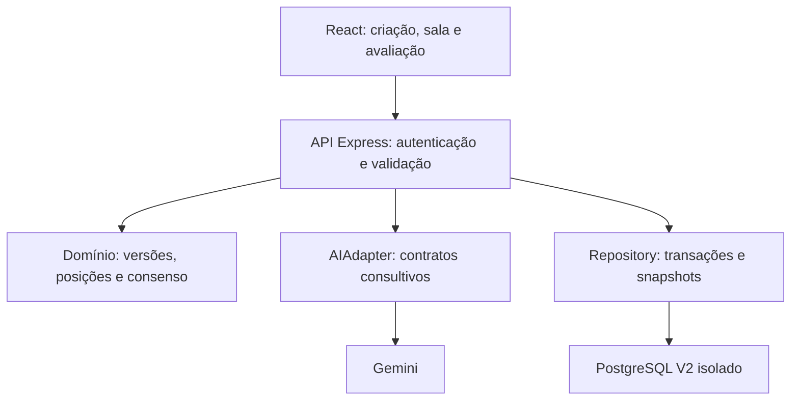
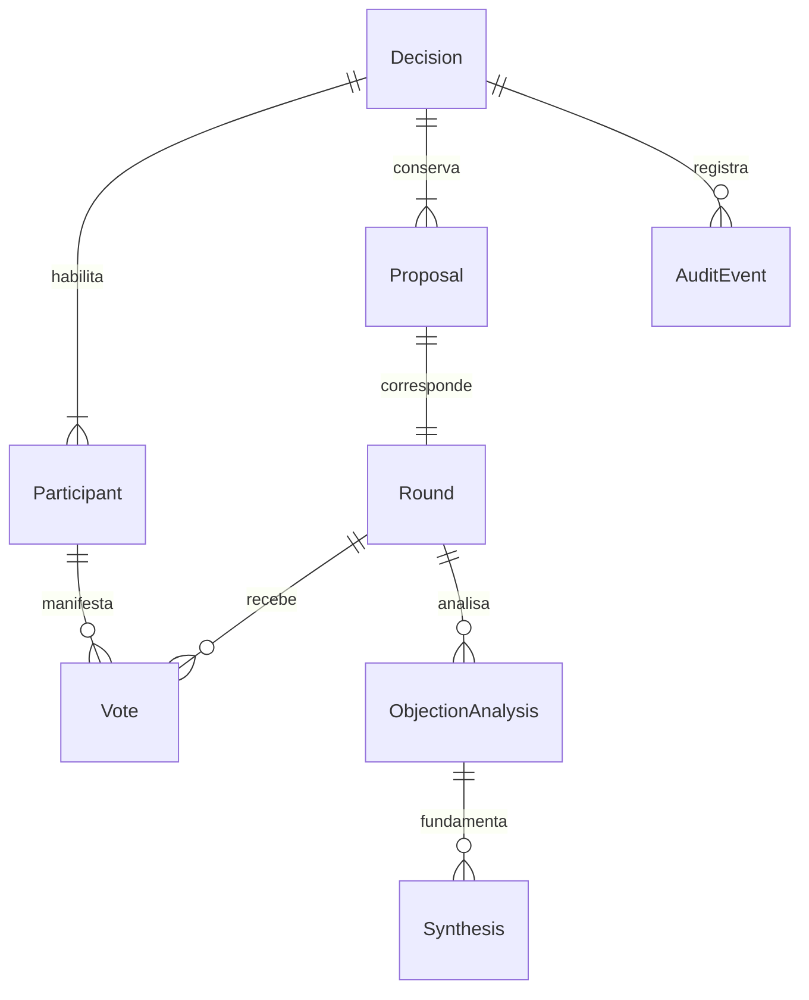
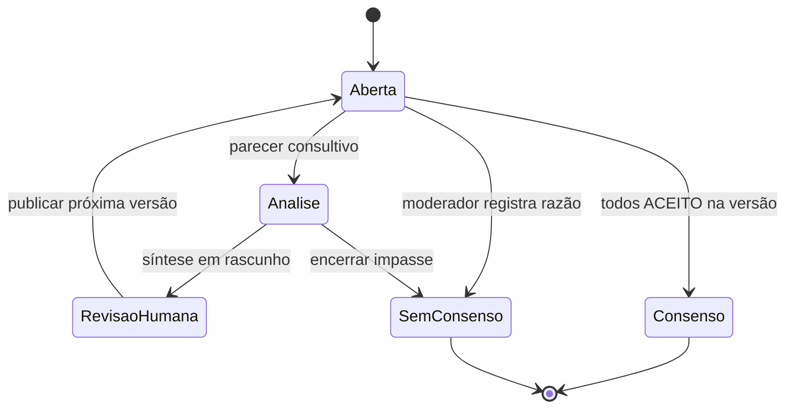

# Especificação integrada V2 — base de 17/11/2026
Estado: implementação de desenvolvimento; sem implantação ou ratificação metodológica presumida.

## Fontes e diferenças de escopo
Fontes primárias de requisitos: `analise_swot_especificacao_consenso.docx` e `questionario_avaliacao_artefato_DSR.docx`, versões 1.0 de 16/11/2026, lidas integralmente (quatro páginas cada).
A monografia oficial no Google Drive foi consultada para preservar o encadeamento acadêmico e as referências existentes.

| Decisão | Especificação do orientador | Decisão do grupo |
|---|---|---|
| Frontend | Svelte, TypeScript, Vite | Manter React, TypeScript, Vite existentes |
| Participação | Simulação local, sem autenticação | Salas remotas, moderador e credenciais Pxx |
| Persistência | localStorage de demonstração | PostgreSQL/Neon isolado, backend como fonte de verdade |
| IA | Adaptador e proxy para chaves privadas | Adaptador Gemini exclusivamente na API |

Estas diferenças não são atribuídas ao orientador. Recomendações SWOT foram analisadas, não convertidas indiscriminadamente em obrigações.

## Justificativa com SWOT
Forças: versionamento, rastreabilidade e revisão humana foram mantidos como base.
Fraquezas: a dependência semântica de LLM permanece; erros não bloqueiam contribuições. A limitação a um navegador motivou a persistência no servidor por decisão do grupo.
Oportunidades: campos livres e estruturados permitem cenários de equipe, planejamento e prioridades, sem alegar generalização empiricamente validada.
Ameaças: vieses e consenso artificial motivam incertezas, contestações e unanimidade determinística; vazamento motiva pseudônimos, minimização e chave no backend; dependência de fornecedor motiva AIAdapter. Texto livre pode conter dados pessoais e revisão humana pode falhar.

## Arquitetura

A interface existente foi ampliada e componentes foram extraídos: ProposalEditor, ReviewCard, RoomWorkspace e EvaluationForm.
`src/api.ts` centraliza requisições; estado de credenciais fica somente em memória.
`shared/contracts.ts` contém schemas Zod; `server/domain.ts` concentra invariantes; `server/app.ts` expõe rotas; `server/db.ts` executa transações; `server/ai.ts` implementa o adaptador.

## Modelo conceitual e armazenamento

Proposal contém parentId, versão, conteúdo estruturado, revisão, autoria de aprovação e data.
Round referencia uma proposta, com número e abertura/encerramento.
Vote referencia participante, rodada e proposta; sucessivos votos são acrescentados, com a última posição vigente por participante/rodada.
Contribuições guardam texto original, texto enviado, parecer e contestação. Preservação começa no rascunho submetido ao parecer ou enviado; não é gravação de cada tecla digitada.
ObjectionAnalysis registra avaliações, vínculos e fingerprint das manifestações usadas. Synthesis registra mudanças, cobertura sugerida, impasses, revisão humana e proposta publicada.
AuditEvent, contestações e respostas DSR pertencem ao processo.

A implementação usa agregados JSONB tipados em `dc2_snapshots`, com chave (room_id, revision), além de `dc2_rooms` e `dc2_participants` para acesso. Entidades conceituais não correspondem a oito tabelas normalizadas. O desenho reduz o custo de implementação do MVP e conserva fotografias anteriores, com custo crescente de armazenamento.
Migrações 001/002 são aditivas, versionadas e verificadas por checksum. `schema.sql` original permanece como referência inicial. `dc2_contributions` anterior não é alterada pela nova operação. Salas V2 antigas sem snapshot recebem orientação de preservação; não são convertidas silenciosamente.

## Regras decisórias
1. Todos os cadastrados na criação estão habilitados; o conjunto não muda durante o processo.
2. ACEITO, REJEITO e ABSTENHO são posições explícitas. PENDENTE é ausência de voto vigente, calculada.
3. REJEITO exige justificativa não vazia. Texto adicional pode ser analisado, editado e enviado sem concordância com o parecer.
4. Consenso decorre exclusivamente de ACEITO vigente de todos os habilitados na mesma proposta/rodada.
5. Nova proposta encerra a rodada anterior, mantém seus dados e abre outra rodada com todos pendentes.
6. Não há limite rígido de três rodadas na V2. Encerramento sem consenso exige razão e é resultado legítimo.
7. IA não altera votos, não publica propostas e não decide consenso.
8. Rejeições com texto normalizado idêntico são sinalizadas em indicadores, sem exclusão. A heurística não prova manipulação nem detecta equivalência semântica.

Revisão manual pode ocorrer sem IA. Rascunho inicial e versões oficiais são preservados separadamente. A regra operacional não representa convicção genuína ou qualidade substantiva da decisão.

## Contratos Gemini
Todos usam schemas de entrada/saída, instruções versionadas `consensus-consultive-v2.0`, modelo configurável e timeout de 30 segundos. Segredos e integração estão no backend.
- analyzeProposal(ProposalContent) → Review: clareza, vieses, pressupostos, lacunas, perguntas, recomendações, reformulação e incertezas.
- analyzeContribution(ProposalContent, texto) → Review: pertinência consultiva, afirmações e limitações.
- analyzeObjections(ProposalContent, votos, contribuições) → Assessment: avaliações de todas as rejeições, citações exatas, premissas, evidências, riscos, interesses, convergências, conflitos, condições inegociáveis e incertezas.
- synthesizeProposal(ProposalContent, Assessment) → SynthesisResult: proposta estruturada, alterações e justificativas, vínculos com rejeições, cobertura sugerida, impasses e viabilidade.

Schemas são enviados como JSON Schema ao Gemini e novamente validados com Zod na resposta. O backend exige cobertura completa das rejeições, IDs existentes e citações literais presentes nas justificativas. Isso reduz erros de estrutura e omissão detectável; não certifica fidelidade semântica.
Análises anteriores a novas manifestações não fundamentam síntese sem nova análise. Mudanças concorrentes durante chamada externa causam 409 e não sobrescrevem a sala.
Pareceres de proposta/contribuição recebem comprovantes HMAC temporários vinculados ao conteúdo, sala, participante e versão, conforme o tipo. Alteração de texto exige novo parecer ou escolha explícita de prosseguir sem ele. Contestações não apagam o original.

| Estatuto factual | Operação da V2 |
|---|---|
| Confirmado por fonte verificável | Indisponível: não há busca externa; o schema recusa confirmação |
| Coerente com contexto fornecido | COMPATIVEL_COM_CONTEXTO, sem comprovação externa |
| Precisa de comprovação | PRECISA_DE_FONTE |
| Não verificável | NAO_VERIFICAVEL |

Não há promessa de neutralidade absoluta, criação de fontes ou filtragem automática de objeções. Falhas guardam código, etapa, versão de prompt e modelo sem registrar segredo ou mensagem privada completa. Falha pré-criação retorna erro explícito; depois da sala, eventos AI_FAILURE são auditados. Ações humanas continuam disponíveis.

## API e autorização
| Rota POST | Permissão |
|---|---|
| /ai/proposal-review | Pública, consentimento e limitação de chamadas |
| /rooms | Pública; parecer assinado ou escolha de prosseguir sem análise |
| /import | Pública, limitada; somente cria nova sala |
| /rooms/:code/view | Credencial da própria sala |
| /rooms/:code/contribution-review, contributions, votes | Participante da própria sala |
| /rooms/:code/analyze-objections, synthesize, publish, close | Moderador da própria sala |
| /rooms/:code/contest, evaluation | Participante da própria sala |
| /rooms/:code/export, evaluation-results | Moderador da própria sala |

GET /health consulta disponibilidade do banco. Respostas não são armazenadas em cache.
Toda mutação exige revision vigente. A transação bloqueia a linha da sala, compara a revisão e insere novo snapshot.
Credenciais aleatórias de 32 bytes são exibidas apenas na criação/restauração. O banco conserva HMAC com pepper de servidor; não retorna hashes nem acessos alheios.
Antes da primeira manifestação na versão atual, a API oculta manifestações, análises e sínteses alheias. Isso não apaga informação vista em rodadas anteriores nem equivale a cegamento experimental integral.
Participantes não recebem respostas DSR de outras pessoas. Exportação de pesquisa é exclusiva do moderador.
Não há CORS amplo; origens são comparadas à mesma origem ou PUBLIC_ORIGIN configurada. HTTPS e proxy são responsabilidades da hospedagem, ainda não realizada.

## Exportação e recuperação
Envelope `dc2-consensus`, version 2: state, metrics, evaluation e proveniência declarada.
Importação valida schema, unicidade, encadeamento, vínculo entre participantes/rodadas/propostas, encerramento e consistência do consenso. IDs de acesso são remapeados, credenciais reemitidas e evento IMPORTED acrescentado. originId é preservado para deduplicação.
Não importa sobre uma sala existente, não usa credenciais exportadas e não comprova autoria ou integridade criptográfica de arquivos externos. Um arquivo pode conter texto livre sensível; proteger o pacote é responsabilidade do pesquisador.
Limite HTTP/importação: 8 MiB; exportações maiores podem precisar de evolução futura. Não foi realizado ensaio de carga.

## Plano de avaliação DSR
Questionário do orientador integral em `shared/instrument.ts`: 22 itens, seis dimensões, A1–A4; escala 1–5, N/A e ausência distinta. Versão registrada por resposta.
Acesso individual pós-encerramento com pelo menos duas rodadas. A sessão pode consensuar antes; não forçar discordância nem aplicar o instrumento fora do procedimento recomendado.
Uma resposta por participante, sem sobrescrita. Frequências e médias descritivas excluem N/A e ausências, apresentando ambos os denominadores. Médias de dimensão são médias dos valores respondidos, não escores psicométricos validados.
Respostas abertas são exportadas por pseudônimo. O relatório de coorte oferece campos de códigos e memorandos vazios; síntese temática requer codificação humana.
Automáticos: consenso formal, rodadas, tempo entre criação e encerramento (inclui espera inicial), votos, objeções por registro e por posição vigente/rodada.
Humanos: cobertura e fidelidade atribuídas pelo moderador na publicação, explicitamente subjetivas. Avaliação independente, qualidade argumentativa e rubrica final permanecem pendentes.
Taxa de consenso: processos concluídos com unanimidade / processos concluídos únicos; abertos fora do denominador e restaurações deduplicadas por originId.
Nenhuma saída é um resultado científico fictício. D19/SUS/D20 e A/B anteriores são históricos; não se presume validade do antigo protocolo na V2.

## Requisitos não funcionais
RNF01: TypeScript estrito e validação de dados no servidor.
RNF02: autorização no backend, pseudônimos e credenciais não expostas.
RNF03: segredos somente no servidor, ambiente V2 separado e confirmação operacional de isolamento.
RNF04: histórico por acréscimo, controle transacional de concorrência e recuperação validada.
RNF05: interface responsiva, rótulos, estados de erro/carregamento, foco visível e navegação simples.
RNF06: falha da IA explícita, sem substituição disfarçada de parecer inteligente.
RNF07: rastreabilidade de prompts, modelo, pareceres, contestações e decisões humanas.
RNF08: referências e avaliação sem alegações de eficácia ou validade não demonstradas.

Histórico append-only é garantia da aplicação, não proteção contra administrador do banco. Segregação de papéis SQL, retenção/exclusão, rotação de credenciais, proteção distribuída e monitoramento de produção devem ser definidos antes de uso real.

## Matriz de correspondência
| Problema | Requisito | Funcionalidade | Componente | Teste executável | Critério de avaliação |
|---|---|---|---|---|---|
| Cenário fixo limita aplicação | RF01 | Proposta genérica estruturada | contracts, ProposalEditor | domain 01; React proposta | DSR 01–03, 21 |
| Ambiguidade na formulação | RF02 | Parecer inicial e reformulação opcional | ai.analyzeProposal, App | ai 02; API 03 | DSR 08, 10 |
| Participação remota | RF03 | Salas e convites | Repository.create | API 03 | Criar sala com ≥3 identidades sintéticas |
| Credenciais expostas | RF04/RNF02 | HMAC e autorização | Repository.authorize | API 04–05 | Segredos ausentes da view/exportação |
| Interferência entre salas | RF04 | Isolamento por identidade | app.auth, db | API 04–05 | Credencial de outra sala retorna 401 |
| Contribuição fora do contexto | RF05 | Parecer consultivo pré-envio | analyzeContribution | ai 06 | DSR 09, 11 |
| Interpretação errada | RF06 | Edição, original e contestação | contribute, contest | domain 07; API 06–08 | DSR 14–15 |
| Rejeição sem razões | RF07 | Justificativa obrigatória | vote | domain 08–09 | Rejeição vazia recusada |
| Silêncio confundido com aceite | RF07 | ABSTENHO/PENDENTE | positions, unanimous | domain/API 09 | Nenhum consenso implícito |
| Mudança apaga decisões | RF08 | Versionamento por acréscimo | publish | domain 10–11 | Rastrear V1 e V2 |
| Voto antigo reaproveitado | RF08 | Vínculo a versão e rodada | vote | API 10–11 | V2 inicia pendente |
| Objeção minoritária omitida | RF09 | Cobertura e citações validadas | addAnalysis | domain 12–14 | DSR 04, 15 |
| Síntese oculta divergência | RF10 | Cobertura/impasses explícitos | addSynthesis | API 13 | DSR 05–07, 13 |
| IA publica sem revisão | RF10 | Confirmação e razão humanas | publish, Workspace | API 14 | DSR 12, 14 |
| Maioria apresentada como consenso | RF11 | ACEITO unânime determinístico | unanimous, vote | domain/API 15 | Critério formal em mesma versão |
| Busca força concordância | RF12 | Encerramento sem consenso | closeWithoutConsensus | domain/API 16 | Razão e resultado conservados |
| Falha externa bloqueia autor | RF05/RNF06 | Prosseguir sem parecer e auditar | AIUnavailable, app | ai/API 17 | Erro não censura contribuição |
| Histórico sem exportação | RF13 | JSON versionado | exportState | API 18 | Versões e pareceres presentes |
| Recuperação sobrescreve dados | RF13 | Sala nova e validação de JSON | ImportSchema, db.create | API 19 | Origem intacta e acessos novos |
| Avaliação incompleta | RF14 | DSR integral e estatísticas | EvaluationForm, statistics | domain/API 20; React DSR | 22 itens, A1–A4, N/A e ausência |

## Casos de uso essenciais
UC01: moderador formula proposta, solicita parecer, mantém/edita/reformula e confirma criação.
UC02: participante entra com código e credencial, registra posição/justificativa e pode contestar.
UC03: moderador analisa objeções e solicita síntese; revê e publica nova versão.
UC04: participantes deliberam novamente; domínio registra unanimidade ou moderador encerra sem consenso.
UC05: participante responde DSR individual; moderador exporta dados e pesquisador realiza análise descritiva/humana.
UC06: responsável restaura exportação em outra sala, com novas credenciais e proveniência declarada.

## Pendências essenciais
O Neon V2 novo foi provisionado e validado com API local real, migrações e reconexão em novo processo. Permanecem a credencial Gemini nova, os quatro contratos reais e o teste remoto HTTPS; consultar INTEGRACAO_REAL_V2.md.
Definir retenção/exclusão, consentimento e rubrica independente de fidelidade/argumentação; ratificar cenário, amostra, condições e instrumento.
Não transportar resultados antigos para a V2, não alterar main/backup/PR4/Streamlit e não afirmar aprovação do orientador para diferenças de escopo.

## Documento acadêmico
A monografia oficial recebeu uma aba adicional “V2 prospectiva — 17-11-2026”, preservando a aba histórica.
https://docs.google.com/document/d/1ZGCZ-e4j87chplYk364C8eU5qUbcmH-fXIhdd6cqFx4/edit?tab=t.r4nlbwyv6bs0

## Integração e execução de produção — 17/11/2026
O Node pode servir dist e /api na mesma origem. O runtime valida PORT, bind, origem HTTPS e separação de segredos; /api/health informa o commit declarado e se há chave configurada, sem afirmar disponibilidade do Gemini. Migrações podem usar DATABASE_URL_V2_DIRECT, separada da conexão pooled de dc2_app. A função de aplicação no Neon real não possui UPDATE ou DELETE em snapshots. O serviço Render existe, porém não está funcional: o envio dos segredos aguarda autorização específica após rejeição da revisão automática.
