# Catálogo de figuras — V2 congelada

Modelos de engenharia elaborados a partir do commit `ea225a5`. O código Mermaid de cada figura está neste arquivo e pode ser editado e exportado para a monografia. Os identificadores F01–F13 são deste catálogo. Na monografia, use a numeração institucional.

## F01 — Casos de uso da deliberação

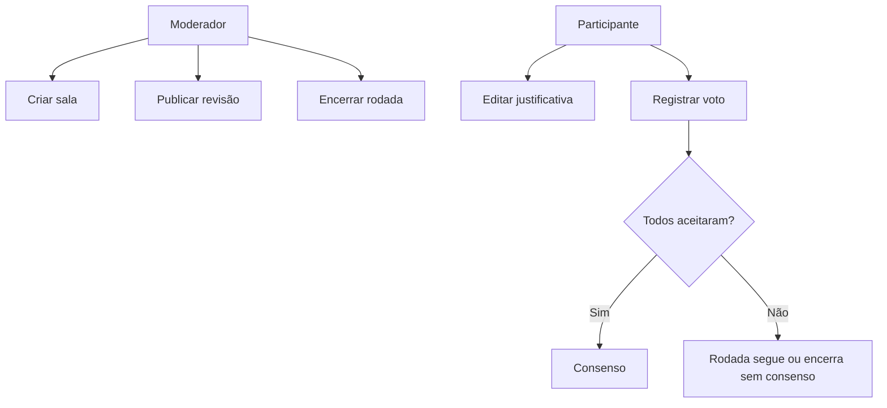

## F02 — Casos de uso de apoio

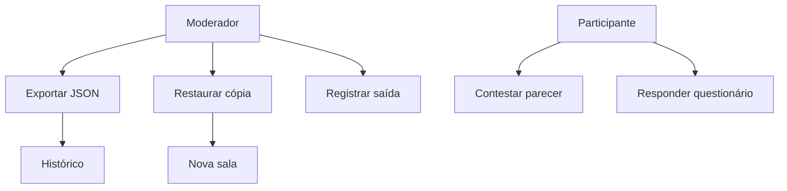

## F03 — Contexto do sistema

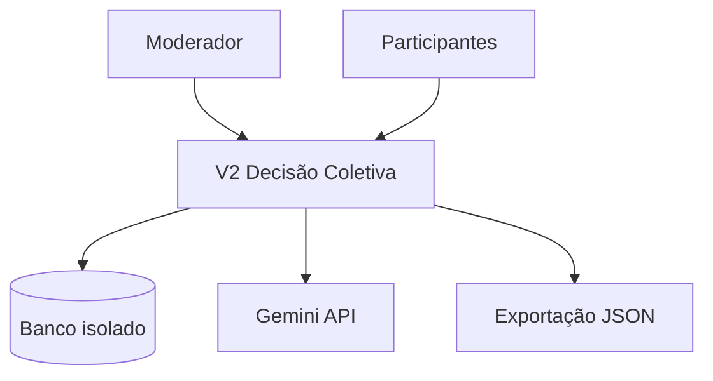

## F04 — Componentes da aplicação

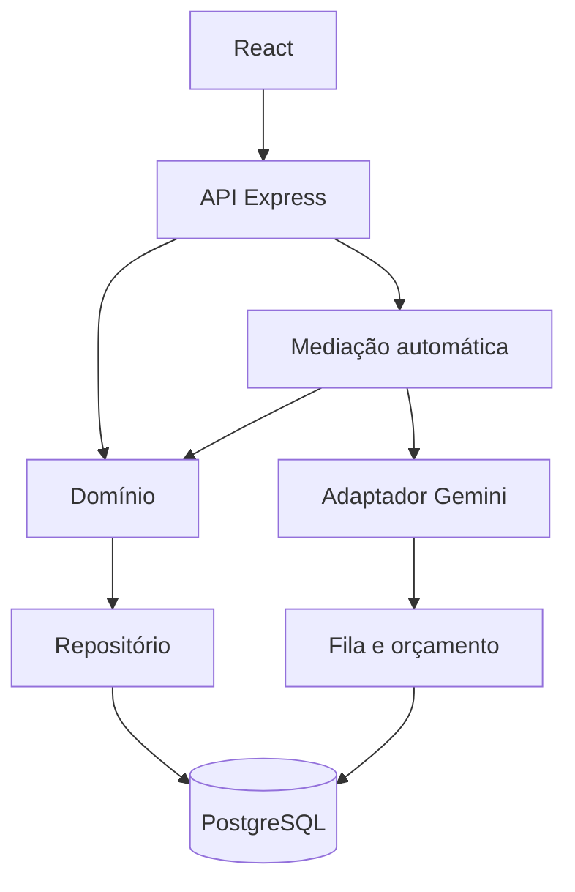

## F05 — Implantação da V2 de validação

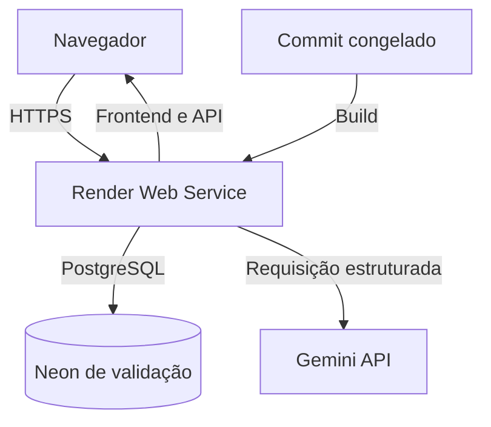

## F06 — Estruturas de domínio

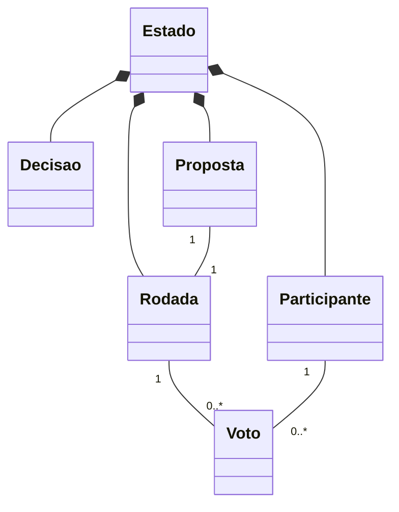

## F07 — Entidades físicas e chaves

```mermaid
erDiagram
 dc2_rooms ||--o{ dc2_participants : possui
 dc2_rooms ||--o{ dc2_snapshots : versiona
 dc2_rooms ||--o{ dc2_contributions : historico
 dc2_participants ||--o{ dc2_contributions : autoria
 dc2_rooms {
   uuid id PK
   varchar code UK
 }
 dc2_participants {
   uuid id PK
   uuid room_id FK
 }
 dc2_snapshots {
   uuid room_id PK, FK
   integer revision PK
   jsonb state
 }
 dc2_contributions {
   uuid id PK
   uuid room_id FK
   uuid participant_id FK
 }
```

## F08 — Relações no estado JSONB

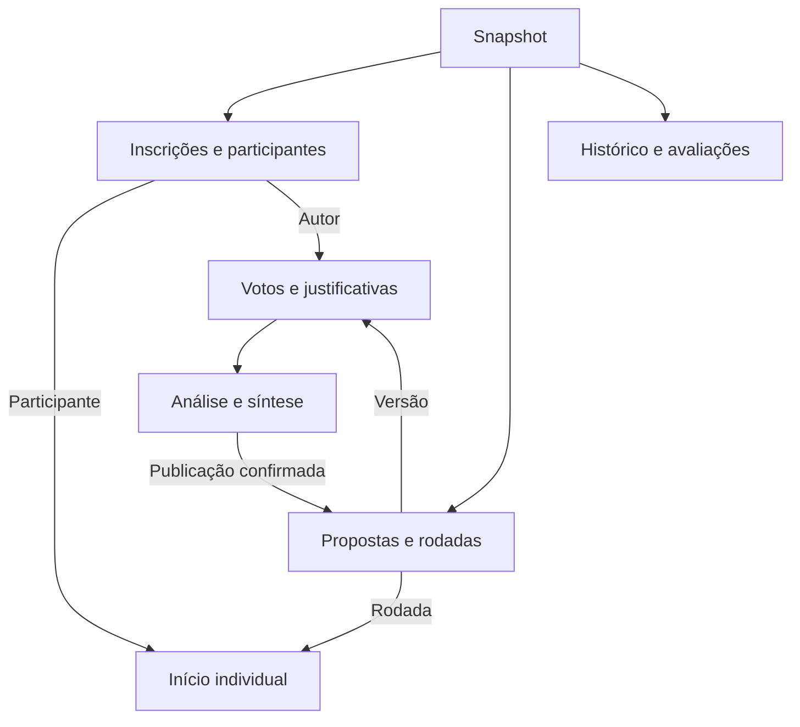

## F09 — Ingresso e voto

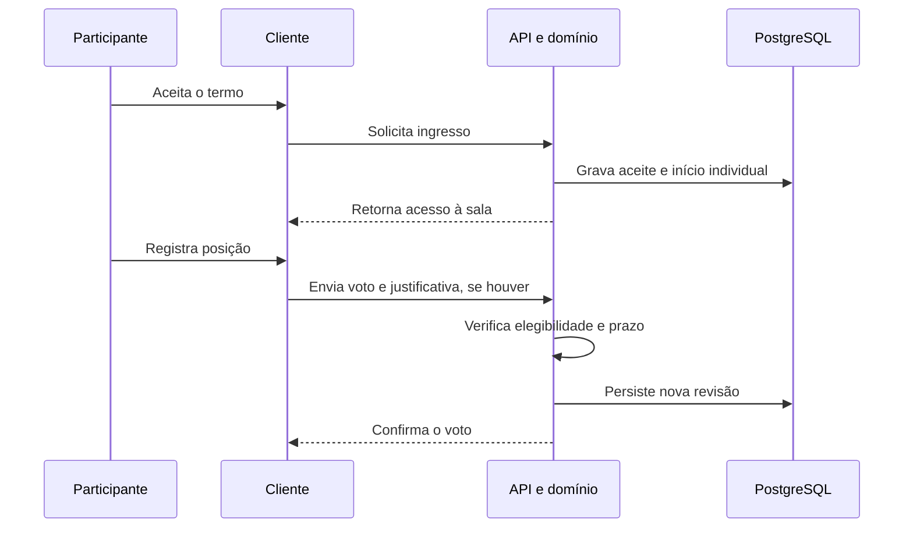

## F10 — Assistência e publicação

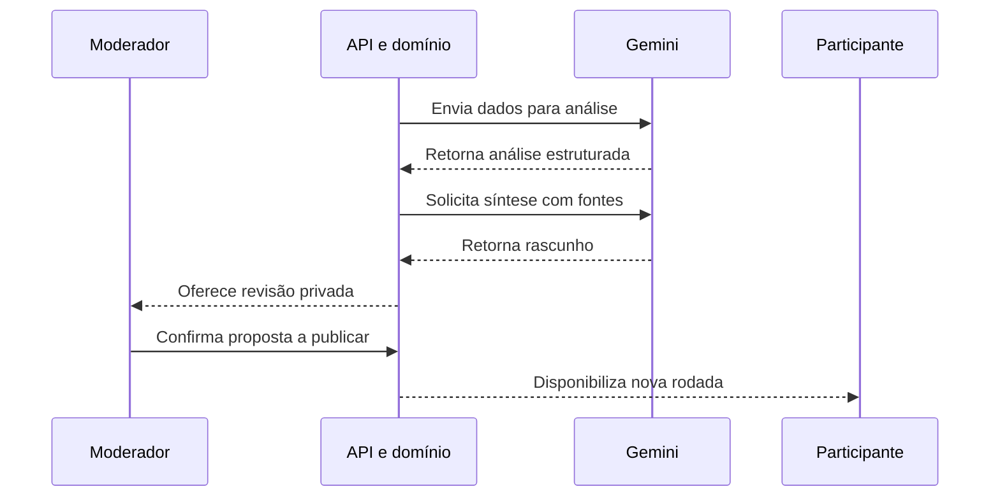

## F11 — Atividade da votação

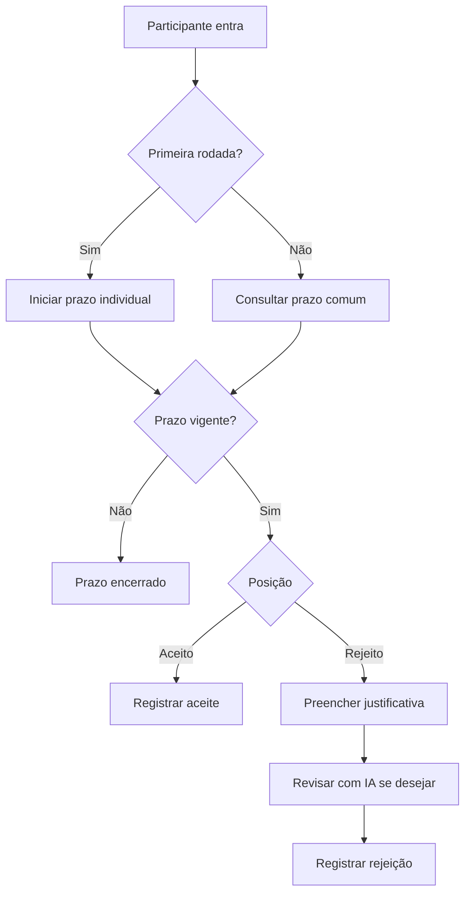

## F12 — Estados da decisão e eventos

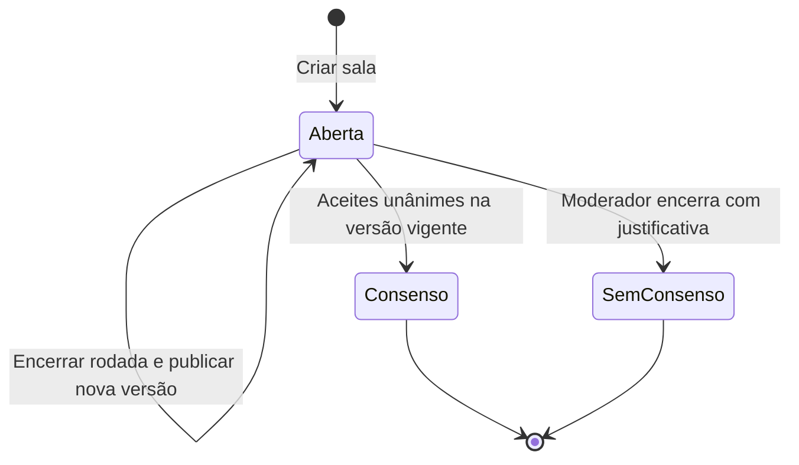

## F13 — Dependências do servidor

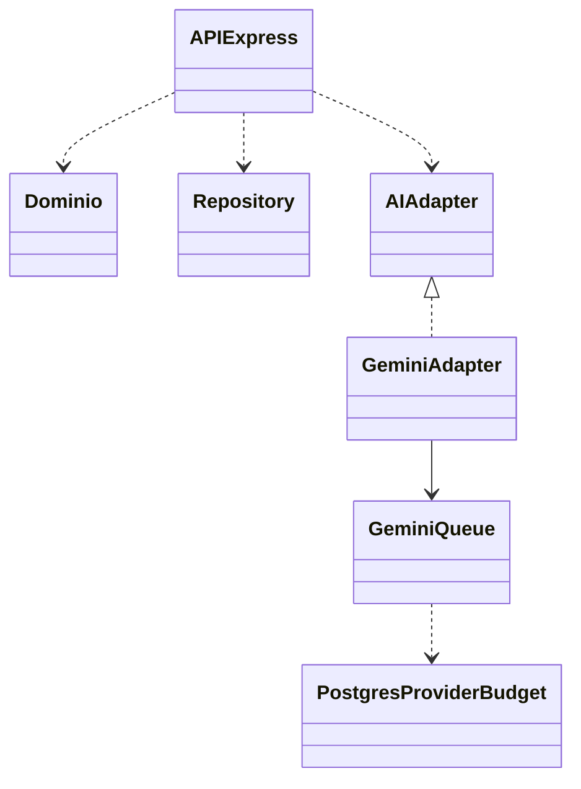

Em F07, as migrações também declaram `dc2_migrations` e `dc2_provider_budget`, tabelas administrativas sem FK de sala. A modelagem F06 projeta tipos TypeScript e relações do snapshot. Em F10, pressupõe-se rodada já encerrada, processo aberto e manifestações textuais disponíveis.
